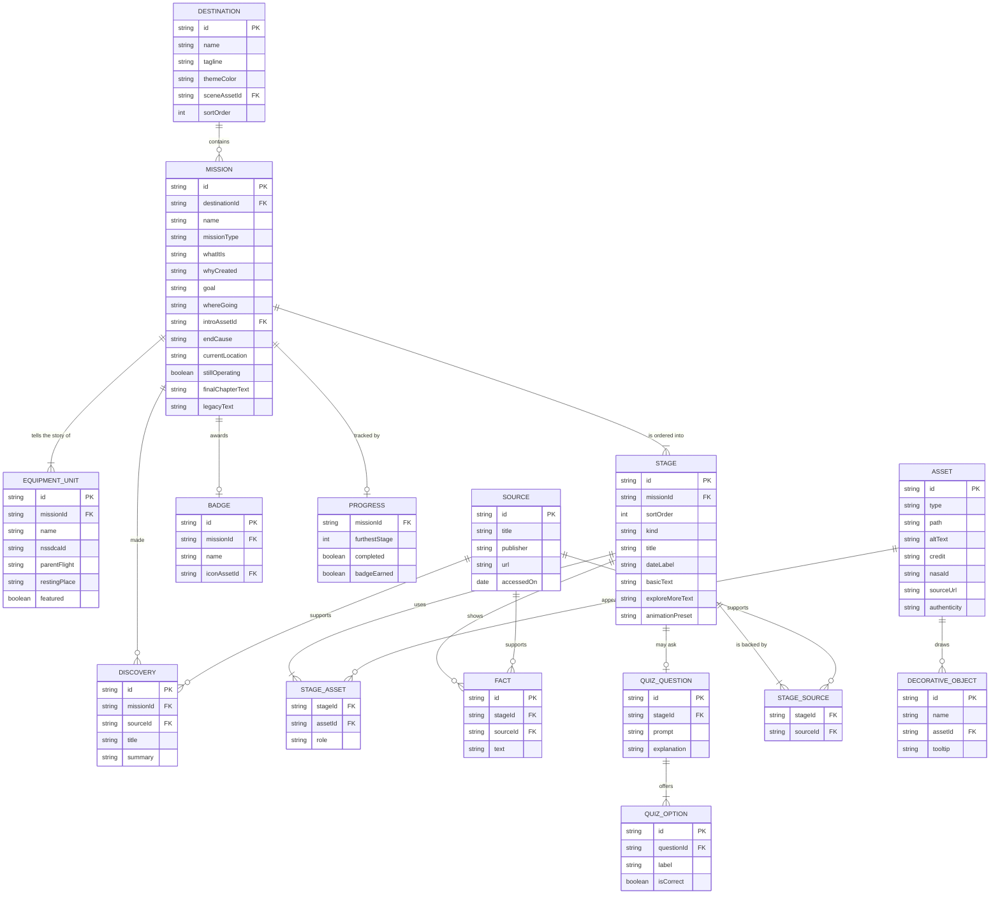
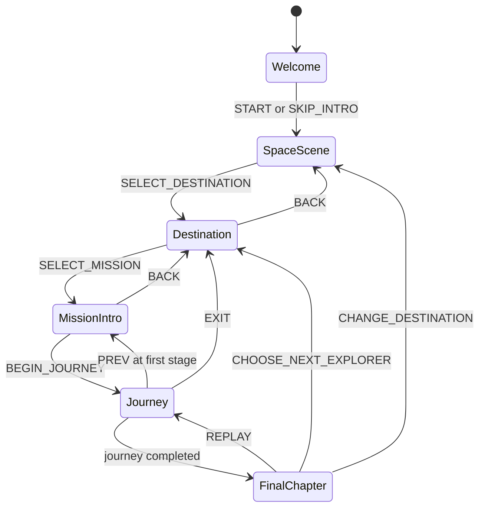
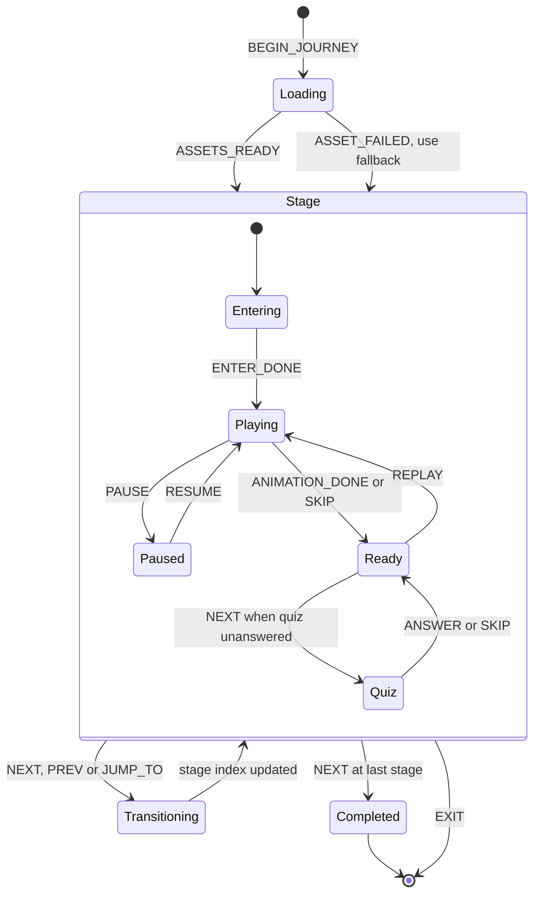
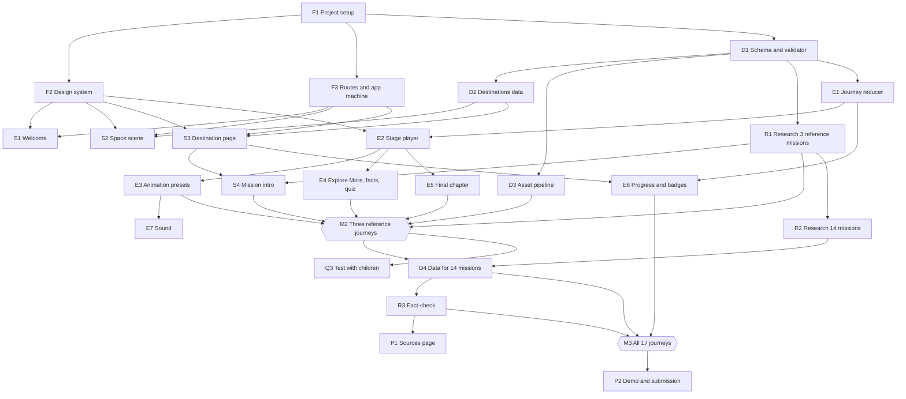

# NASA Space Apps 2026 — System Design

Companion to [NASA_Project_Blueprint.md](NASA_Project_Blueprint.md). This document defines four things the team builds from:

1. **Relations** — the entities in the project and how they connect.
2. **Database** — where that data lives and its exact shape.
3. **State machines** — how the app and the journey engine move between states.
4. **Subtasks** — the work breakdown, with dependencies and owners.

The diagrams are Mermaid. They render on GitHub and in VS Code with the "Markdown Preview Mermaid Support" extension.

**Scope used here:** 17 full journeys (4 Moon, 8 Mars, 5 Deep Space), as in the team brief. The blueprint lists 15 and leaves the choice open; the brief adds Ingenuity and separates the pairs, so this document follows the brief.

---

## 1. Relations

### 1.1 The core idea

One **Destination** contains many **Missions**. A Mission is one story (one journey). A Mission is told through ordered **Stages**, and every Stage carries its own visuals, facts, optional quiz, and sources. Nothing about the order or number of stages is fixed in code — it comes from the data, which is how different mission histories are supported.

### 1.2 Entity-relationship diagram



### 1.3 Rules the relations enforce

| Rule | How the model enforces it |
|---|---|
| Different missions have different timelines | `STAGE.sortOrder` and `STAGE.kind` are data. A mission has as many stages as its history needs. |
| Grouped entries hold several real objects | `MISSION` 1→many `EQUIPMENT_UNIT`. "Apollo Lunar Modules" is one journey; each descent stage is a unit, with one marked `featured`. |
| Decorative objects never become missions | `DECORATIVE_OBJECT` has no link to `MISSION` or `STAGE`. The ISS or a shuttle can only be drawn. |
| Every claim is traceable | A `STAGE` needs at least one `STAGE_SOURCE`; every `FACT` and `DISCOVERY` needs a `sourceId`. |
| Real footage is separated from reconstruction | `ASSET.authenticity` is `real` or `reconstruction`; the UI labels reconstructions. |
| Endings are never all "abandoned" | `endCause`, `currentLocation`, and `stillOperating` are three separate fields. |
| One site for ages 9–15 | `basicText` is always shown; `exploreMoreText` opens on request. |

### 1.4 Controlled values

| Field | Allowed values |
|---|---|
| `MISSION.missionType` | `crewed-lander-stage`, `surface-vehicle`, `instrument-package`, `lander`, `rover`, `helicopter`, `orbiter`, `flyby-probe`, `space-telescope` |
| `MISSION.endCause` | `intentionally-left`, `switched-off`, `stopped-operating`, `communication-lost`, `fuel-exhausted`, `still-operating` |
| `MISSION.currentLocation` | `planetary-surface`, `in-orbit`, `solar-orbit`, `leaving-solar-system` |
| `STAGE.kind` | `origin`, `build`, `launch`, `cruise`, `flyby`, `orbit-insertion`, `landing`, `deployment`, `operations`, `discovery`, `ending`, `legacy` |
| `STAGE_ASSET.role` | `background`, `foreground`, `gallery`, `video`, `narration` |
| `ASSET.authenticity` | `real`, `reconstruction` |

### 1.5 The 17 missions mapped to the model

Type and ending category are working classifications from general knowledge. **Each row must be confirmed against NSSDCA or science.nasa.gov before it is entered as data** (task R1/R2).

| Destination | Mission (journey) | `missionType` | Units | Ending category to verify |
|---|---|---|---|---|
| Moon | Apollo Lunar Modules | `crewed-lander-stage` | Descent stages of the six landings; Apollo 11 Eagle featured | `intentionally-left` |
| Moon | Lunar Roving Vehicles | `surface-vehicle` | Apollo 15, 16, 17 rovers | `intentionally-left` |
| Moon | ALSEP | `instrument-package` | Apollo 12, 14, 15, 16, 17 packages (Apollo 11 carried the smaller EASEP) | `switched-off` |
| Moon | Surveyor Landers | `lander` | The Surveyors that landed; Surveyor 3 featured | `stopped-operating` |
| Mars | Sojourner | `rover` | 1 | `communication-lost` |
| Mars | Spirit | `rover` | 1 | `communication-lost` |
| Mars | Opportunity | `rover` | 1 | `communication-lost` |
| Mars | Viking 1 Lander | `lander` | 1 | `communication-lost` |
| Mars | Viking 2 Lander | `lander` | 1 | `stopped-operating` |
| Mars | Phoenix | `lander` | 1 | `stopped-operating` |
| Mars | InSight | `lander` | 1 | `stopped-operating` |
| Mars | Ingenuity | `helicopter` | 1 | `stopped-operating` |
| Deep Space | Dawn | `orbiter` | 1 | `fuel-exhausted`, `in-orbit` |
| Deep Space | NEAR Shoemaker | `orbiter` | 1 | `switched-off`, `planetary-surface` |
| Deep Space | Pioneer 10 | `flyby-probe` | 1 | `communication-lost`, `leaving-solar-system` |
| Deep Space | Pioneer 11 | `flyby-probe` | 1 | `communication-lost`, `leaving-solar-system` |
| Deep Space | Kepler | `space-telescope` | 1 | `fuel-exhausted`, `solar-orbit` |

---

## 2. Database

### 2.1 Decision: static JSON, no server database

The content is read-only, small (17 missions), and written by the team, not by users. A server and database would add hosting, an API, and failure points without giving the child anything. So:

| Data | Where it lives | Why |
|---|---|---|
| Destinations, missions, stages, facts, quizzes, sources, assets | JSON files in `src/data/`, bundled at build time | Fast, works offline, versioned in Git, reviewable in pull requests |
| Images, video, audio | `public/` folders, referenced by `ASSET.path` | Served as static files |
| Child's progress and badges | Browser `localStorage` | No accounts, no personal data collected from children |

The schema below is relational on purpose. If the project later needs accounts or a CMS, each entity becomes a PostgreSQL table with the same columns and keys.

### 2.2 File layout

```text
src/data/
├── destinations.json          DESTINATION[]
├── decorative-objects.json    DECORATIVE_OBJECT[]
├── sources.json               SOURCE[]            (shared, referenced by id)
├── assets.json                ASSET[]             (shared, referenced by id)
├── missions/
│   ├── index.json             id, name, destinationId, card image — for mission cards
│   ├── opportunity.json       one MISSION with units, stages, facts, quiz, discoveries, badge
│   ├── apollo-lunar-modules.json
│   └── ...                    17 files
└── schema.ts                  types + validator (single source of truth)
```

One file per mission means two people never edit the same file, and each journey loads only when the child opens it.

### 2.3 Schema (TypeScript)

```ts
type ID = string;

interface Destination {
  id: 'moon' | 'mars' | 'deep-space';
  name: string;
  tagline: string;            // one sentence shown in the space scene
  themeColor: string;
  sceneAssetId: ID;
  sortOrder: number;
}

interface Mission {
  id: ID;                     // also the URL slug
  destinationId: Destination['id'];
  name: string;
  missionType: MissionType;
  intro: {                    // Stage 4 of the user journey
    whatItIs: string;
    whyCreated: string;
    goal: string;
    whereGoing: string;
    assetId: ID;
  };
  units: EquipmentUnit[];     // at least 1
  stages: Stage[];            // ordered; at least 3
  discoveries: Discovery[];
  ending: {                   // Stage 6 of the user journey
    endCause: EndCause;
    currentLocation: CurrentLocation;
    stillOperating: boolean;
    finalChapterText: string;
    legacyText: string;
  };
  badge?: { name: string; iconAssetId: ID };
}

interface EquipmentUnit {
  id: ID;
  name: string;               // e.g. "Apollo 11 Eagle descent stage"
  nssdcaId?: string;          // e.g. "1969-059C"
  parentFlight?: string;
  restingPlace?: string;
  featured: boolean;
}

interface Stage {
  id: ID;
  kind: StageKind;
  title: string;
  dateLabel?: string;         // shown on the timeline
  basicText: string;          // max ~40 words
  exploreMoreText?: string;   // optional deeper layer
  animationPreset: StageKind | 'none';
  assets: { assetId: ID; role: AssetRole }[];
  facts: { id: ID; text: string; sourceId: ID }[];
  quiz?: {
    prompt: string;
    options: { label: string; isCorrect: boolean }[];   // exactly one correct
    explanation: string;
  };
  sourceIds: ID[];            // at least 1
}

interface Discovery { id: ID; title: string; summary: string; sourceId: ID; }

interface Asset {
  id: ID;
  type: 'image' | 'video' | 'audio';
  path: string;
  altText: string;
  credit: string;             // e.g. "NASA/JPL-Caltech"
  nasaId?: string;            // id in images.nasa.gov
  sourceUrl: string;
  authenticity: 'real' | 'reconstruction';
}

interface Source { id: ID; title: string; publisher: string; url: string; accessedOn: string; }

interface DecorativeObject { id: ID; name: string; assetId: ID; tooltip: string; }

// localStorage key "journey-progress"
type Progress = Record<ID, { furthestStage: number; completed: boolean; badgeEarned: boolean }>;
```

### 2.4 Integrity checks (run on every build)

A validation script fails the build when any of these is false:

1. Every `assetId` and `sourceId` exists in `assets.json` / `sources.json`.
2. Every mission has a valid `destinationId`, at least one unit, and exactly one `featured` unit.
3. Every stage has at least one source and one `background` asset.
4. Every quiz has exactly one correct option.
5. Every asset has `credit`, `altText`, and `sourceUrl`.
6. Each mission's last two stages are `ending` then `legacy`.
7. `basicText` is within the word limit.

A missing image file does not fail the build; it is reported, and the UI shows the destination's fallback background.

---

## 3. State diagrams and state machines

There are two machines. The **App machine** decides which screen the child is on. The **Journey machine** runs inside one screen and controls the stage-by-stage story.

### 3.1 App machine (screens)



Each state is a URL, so the browser Back button and shared links work:

| State | Route | Primary action on screen |
|---|---|---|
| Welcome | `/` | Start Your Journey |
| SpaceScene | `/explore` | Pick a destination |
| Destination | `/explore/:destinationId` | Pick a mission card |
| MissionIntro | `/mission/:missionId` | Begin the Journey |
| Journey | `/mission/:missionId/journey/:stageNumber` | Next |
| FinalChapter | `/mission/:missionId/legacy` | Which explorer next? |

A returning child (progress found in `localStorage`) lands on Welcome with a visible Skip.

### 3.2 Journey machine (the engine)



**Context** (data the machine carries):

| Field | Meaning |
|---|---|
| `missionId` | Which mission data is loaded |
| `stageIndex`, `stageCount` | Position; drives the progress indicator |
| `furthestStage` | Highest stage reached; the timeline only allows jumps up to here |
| `answered` | Stage ids whose quiz has been answered or skipped |
| `exploreMoreOpen` | Whether the deeper layer is showing (resets on each stage) |
| `soundOn` | Narration and effects toggle |

**Transition table:**

| Current state | Event | Guard | Next state | Side effect |
|---|---|---|---|---|
| Loading | `ASSETS_READY` | — | Stage.Entering | — |
| Loading | `ASSET_FAILED` | — | Stage.Entering | Swap in fallback image |
| Entering | `ENTER_DONE` | — | Playing | Start stage animation and narration |
| Entering | — | Reduced motion on | Ready | Show final frame |
| Playing | `PAUSE` | — | Paused | Freeze animation and audio |
| Paused | `RESUME` | — | Playing | Continue |
| Playing | `ANIMATION_DONE` / `SKIP` | — | Ready | Highlight Next button |
| Ready | `REPLAY` | — | Playing | Restart animation |
| Ready | `NEXT` | Stage has quiz, not answered | Quiz | Open question |
| Quiz | `ANSWER` / `SKIP` | — | Ready | Record in `answered`; show explanation |
| Any Stage substate | `NEXT` | Not last; quiz done or absent | Transitioning | `stageIndex + 1`; save progress |
| Any Stage substate | `PREV` | `stageIndex > 0` | Transitioning | `stageIndex - 1` |
| Any Stage substate | `PREV` | `stageIndex = 0` | (App: MissionIntro) | — |
| Any Stage substate | `JUMP_TO(n)` | `n ≤ furthestStage` | Transitioning | `stageIndex = n` |
| Transitioning | scene change finished | — | Stage.Entering | Preload next stage's assets |
| Any Stage substate | `NEXT` | Last stage | Completed | Mark completed; award badge |
| Any | `EXIT` | — | (App: Destination) | Save progress |

Design choices in this table:

- **Next is never locked behind the animation.** A child can press Next during Playing. Quizzes can be skipped. Nothing traps the child.
- **Wrong answers do not block.** The explanation is shown and the story continues.
- **The machine knows nothing about rovers or orbiters.** It only moves an index through a list. Mission differences live entirely in the data, so adding a mission needs no engine changes.

### 3.3 Implementation

Use React's `useReducer` — the machine is small enough that a state-machine library would be an unnecessary dependency.

```ts
type Phase = 'loading' | 'entering' | 'playing' | 'paused' | 'ready' | 'quiz'
           | 'transitioning' | 'completed';

interface JourneyState {
  phase: Phase;
  stageIndex: number;
  stageCount: number;
  furthestStage: number;
  answered: string[];
  exploreMoreOpen: boolean;
}

type JourneyEvent =
  | { type: 'ASSETS_READY' } | { type: 'ASSET_FAILED' }
  | { type: 'ENTER_DONE' } | { type: 'ANIMATION_DONE' }
  | { type: 'PAUSE' } | { type: 'RESUME' } | { type: 'REPLAY' } | { type: 'SKIP' }
  | { type: 'NEXT'; hasQuiz: boolean; stageId: string }
  | { type: 'PREV' } | { type: 'JUMP_TO'; index: number }
  | { type: 'ANSWER'; stageId: string }
  | { type: 'TRANSITION_DONE' }
  | { type: 'TOGGLE_EXPLORE_MORE' };

function journeyReducer(state: JourneyState, event: JourneyEvent): JourneyState;
```

The reducer is a pure function, so every row of the transition table becomes one unit test. `EXIT` and `PREV` at stage 0 are handled by the router, not the reducer.

---

## 4. Subtasks

### 4.1 Roles

| Member | Role | Owns |
|---|---|---|
| CS student 1 | **Engine lead** | Journey machine, stage player, routing |
| CS student 2 | **Screens lead** | Design system, welcome, space scene, destination pages |
| CS student 3 | **Animation lead** | Stage animation presets, transitions, sound |
| Computer Engineering student | **Data and build lead** | Schema, validator, asset pipeline, performance, deployment |
| Cybersecurity student | **Content and quality lead** | NASA research, sources, image credits, fact-check, testing |

Mission content is too large for one person. Once the three reference journeys are done, all five members write mission data (see D4).

### 4.2 Task list

Each task lists what it depends on. A task can start only when its dependencies are finished.

**Foundation**

| ID | Task | Depends on | Owner |
|---|---|---|---|
| F1 | Create the project (React, Vite, TypeScript, Tailwind, Framer Motion) and deploy an empty page | — | Data/build |
| F2 | Design system: colors, type, Button, Card, Panel, ProgressIndicator | F1 | Screens |
| F3 | Routes and app machine (section 3.1) with placeholder screens | F1 | Engine |

**Data**

| ID | Task | Depends on | Owner |
|---|---|---|---|
| D1 | Write `schema.ts` and the build validator (sections 2.3, 2.4) | F1 | Data/build |
| D2 | `destinations.json`, `decorative-objects.json`, mission card index | D1 | Data/build |
| D3 | Asset pipeline: resize, convert to WebP, register in `assets.json` with credits | D1 | Data/build |
| D4 | Mission data files for the 14 remaining missions | D1, R2, M2 | Everyone |

**Research**

| ID | Task | Depends on | Owner |
|---|---|---|---|
| R1 | Research the 3 reference missions: dates, events, discoveries, ending, images, sources | D1 | Content |
| R2 | Research the remaining 14 missions using the same template | R1 | Content + 1 |
| R3 | Fact-check: a second person checks every stage against its source | D4 | Content |

**Screens**

| ID | Task | Depends on | Owner |
|---|---|---|---|
| S1 | Welcome screen with short animated NASA intro and Skip | F2, F3 | Screens |
| S2 | Space scene: destinations, decorative objects, "not to scale" label | F2, F3, D2 | Screens |
| S3 | Destination page with mission cards and completed marks | F2, F3, D2 | Screens |
| S4 | Mission intro screen | S3, R1 | Screens |

**Engine**

| ID | Task | Depends on | Owner |
|---|---|---|---|
| E1 | Journey reducer and unit tests (sections 3.2, 3.3) | D1 | Engine |
| E2 | Stage player: scene, text, Next/Previous/Pause/Replay/Skip, timeline | E1, F2 | Engine |
| E3 | Animation presets, one per `StageKind`, plus scene transitions | E2 | Animation |
| E4 | Explore More layer, Did You Know cards, quiz | E2 | Engine |
| E5 | Final chapter screen: ending status, legacy, "Which explorer next?" | E2 | Screens |
| E6 | Progress and badges in `localStorage` | E1, S3 | Engine |
| E7 | Sound effects and narration toggle (optional) | E3 | Animation |

**Quality and presentation**

| ID | Task | Depends on | Owner |
|---|---|---|---|
| Q1 | Responsive layouts: phone, tablet, desktop | S1–S4, E2 | Screens |
| Q2 | Accessibility: contrast, keyboard use, reduced motion, alt text | E3, E4 | Content |
| Q3 | Test with 2–3 children in the age range; fix what confuses them | M2 | Content |
| Q4 | Performance: load each mission on demand, check image sizes | D3, E2 | Data/build |
| P1 | Sources and credits page showing how NASA data is used | R3 | Content |
| P2 | Demo script, demo video, submission text | M3 | Everyone |

### 4.3 Dependency graph



### 4.4 Milestones

| Milestone | Definition of done | Tasks included |
|---|---|---|
| **M1 — Walking skeleton** | One mission can be clicked through from Welcome to Final Chapter with placeholder visuals | F1–F3, D1, D2, E1, E2, S1–S3 |
| **M2 — Three reference journeys** | Three finished, sourced, animated journeys | R1, D3, S4, E3, E4, E5 |
| **M3 — All 17 journeys** | Every mission passes the validator and the fact-check | R2, D4, R3, E6 |
| **M4 — Submission** | Tested on three screen sizes; demo recorded | Q1–Q4, E7, P1, P2 |

### 4.5 The three reference missions

Chosen because together they exercise every part of the engine before the other 14 are written:

| Mission | What it proves |
|---|---|
| **Opportunity** | Standard rover path: launch, cruise, landing, surface exploration, loss of contact |
| **Apollo Lunar Modules (Eagle)** | A group with several units; a crewed mission; equipment left on purpose; no "it broke" ending |
| **Pioneer 10** | No landing at all: flybys, a trajectory out of the solar system, a fading signal |

If the engine and schema handle these three without special-case code, the remaining 14 are content work only.

### 4.6 What runs in parallel

After F1 and D1, four tracks are independent and should run at the same time:

- **Engine track:** E1 → E2 → E4
- **Screens track:** F2 → S1 → S2 → S3
- **Data track:** D2 → D3
- **Research track:** R1 → R2

The tracks meet at M2. The critical path is **F1 → D1 → E1 → E2 → E3 → M2 → D4 → R3 → M3**; a delay on any of these delays the submission.

---

## 5. Open decisions for the team

1. **Grouped Moon entries.** This design gives each group one journey with several units (4 Moon journeys). The alternative is one journey per landing, which would raise the Moon count from 4 to roughly 19. Recommended: keep one journey per group.
2. **Narration (E7).** Optional. Decide after M2 whether there is time to record or generate audio for 17 missions.
3. **Language.** If the site needs Arabic as well as English, text fields must become `{ en, ar }` in the schema before D4 starts — changing it afterwards means editing all 17 files.
